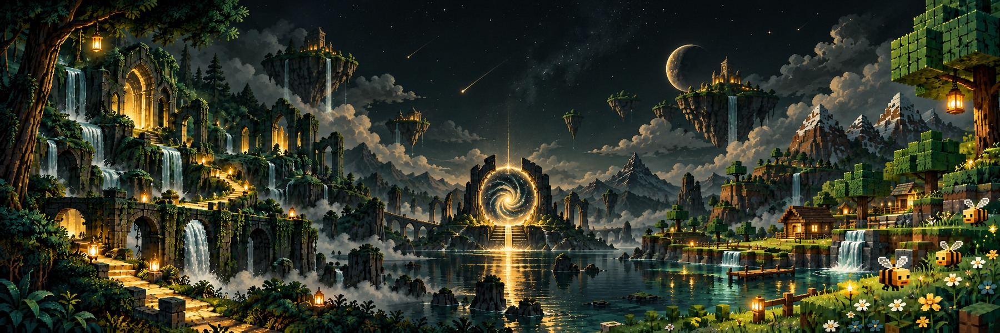
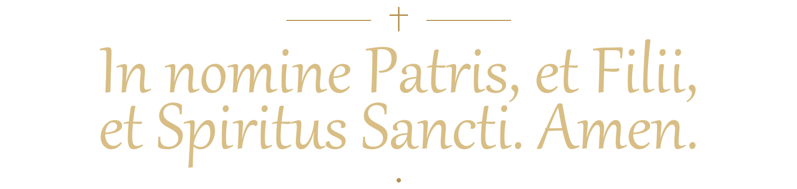

  <picture>
    <source media="(prefers-color-scheme: dark)" srcset="assets/banner-elegant-dark.jpg">
    <source media="(prefers-color-scheme: light)" srcset="assets/banner-elegant-light.jpg">
    
  </picture>

<h1 align="center">Getsemani Chuc Arias</h1>

  <strong>Ingeniería en Tecnologías de la Información y Comunicación · titulación en curso</strong> 
  Desarrollo software que convierte procesos manuales en herramientas que ya usan negocios reales.

  
  &nbsp;&nbsp;
  
  &nbsp;&nbsp;
  

Explora Hyrule, construye en bloques y resuelve misiones del mundo real.

---

## 🧭 Mi misión

Lidero **Lyra Lavender Solutions**: transformo procesos manuales en apps y sistemas listos para operar.

**Más de 6 clientes** · análisis → desarrollo → implementación → soporte.

## ⚔️ Misiones del mundo real

<table>
<tr>
<td width="50%"><strong>🍽️ Lyra POS</strong> <strong>5 sucursales · ~17 usuarios diarios</strong> Comandas, caja e inventario.</td>
<td width="50%"><strong>🏋️ Barracuda Gym</strong> <strong>4 sucursales · 800+ socios</strong> Pagos, acceso y biometría.</td>
</tr>
<tr>
<td><strong>💪 The Anatomy</strong> <strong>400+ socios</strong> Gestión diaria que sustituyó Excel y papel.</td>
<td><strong>🛎️ King Crunch</strong> <strong>3 sucursales</strong> Plataforma de pedidos en operación.</td>
</tr>
<tr>
<td><strong>🌸 FlorExpress</strong> Marketplace full stack con usuarios y pedidos reales durante su operación.</td>
<td><strong>🛠️ Alan’s Handyman</strong> Sitio, dominio y despliegue que generaron clientes.</td>
</tr>
</table>

## 🎒 Inventario técnico

`Flutter / Dart` · `Firebase` · `PostgreSQL` · `MySQL` · `SQLite`  
`JavaScript` · `HTML / CSS` · `Git / GitHub`

🔧 Abrir herramientas de soporte

Python · PHP · APIs · WebSockets · hosting y DNS · LAN / Wi-Fi · impresión térmica · biometría.

## 🎓 Formación

**Ingeniería en TIC · ITSCH · 2021–2026**  
Egresado · titulación en curso · **excelencia académica**.

📜 Ver formación extra e idiomas

- Asesoría e instrucción de un taller de robótica para estudiantes de nivel básico.
- Introducción a las Tecnologías Emergentes — Emtech Institute & Santander Open Academy, 2024.
- Español nativo · inglés conversacional y lectura de documentación técnica.

## Contacto

- **Correo:** [lyralavender.solutions@gmail.com](mailto:lyralavender.solutions@gmail.com)
- **Teléfono:** [+52 786 263 5467](tel:+527862635467)
- **Sitio:** [lyrave-solutions.com](https://lyrave-solutions.com)

Me interesa colaborar en desarrollo de software, automatización e implementación tecnológica.

---

  
Créditos del equipo de Zelda

  Los iconos de la **Espada Maestra** y el **Escudo Hyliano** pertenecen a *The Legend of Zelda: Breath of the Wild* y Nintendo. Procedencia: [Espada Maestra — MelonSpeedruns / Zelda Wiki](https://zeldawiki.wiki/wiki/File:BotW_Master_Sword_Icon.png) y [Escudo Hyliano — The Spriters Resource / Zelda Wiki](https://zeldawiki.wiki/wiki/File:BotW_Hylian_Shield_Icon.png).

---

  <picture>
    <source media="(prefers-color-scheme: dark)" srcset="assets/latin-footer-dark.png">
    <source media="(prefers-color-scheme: light)" srcset="assets/latin-footer-light.png">
    
  </picture>

