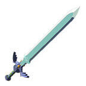
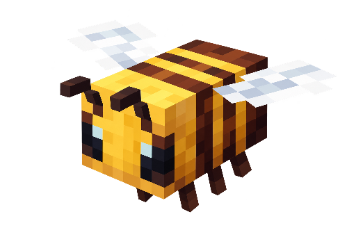

  

<h1 align="center">Getsemani Chuc Arias</h1>

  <strong>Ingeniería en Tecnologías de la Información y Comunicación · titulación en curso</strong> 
  Desarrollo software que convierte procesos manuales en herramientas que ya usan negocios reales.

  
  &nbsp;&nbsp;
  
  &nbsp;&nbsp;
  

Explora Hyrule, construye en bloques y resuelve misiones del mundo real.

---

## Sobre mí

Soy egresado de Ingeniería en TIC y lidero **Lyra Lavender Solutions**, donde llevo proyectos tecnológicos de principio a fin: análisis de necesidades, propuesta, desarrollo, implementación, publicación, soporte y mantenimiento. He atendido a **más de 6 clientes reales** y me enfoco en automatizar operaciones de forma práctica y confiable.

## Sistemas en uso real

| Proyecto | Alcance e impacto |
| --- | --- |
| **Lyra POS** | En **5 sucursales**, usado por unas **17 personas al día** para comandas, caja, inventario y administración. |
| **Barracuda Gym** | En **4 sucursales**, con **800+ socios** y 7–8 empleados; integra membresías, pagos, acceso y biometría operativa. |
| **The Anatomy** | Gestión diaria de **400+ socios** desde diciembre de 2025; sustituyó Excel, papel y libretas. |
| **King Crunch** | Plataforma de pedidos operada en **3 sucursales**. |
| **FlorExpress** | Marketplace full stack con usuarios y pedidos reales durante su operación. |
| **Alan’s Handyman** | Sitio web, dominio, hosting, DNS y mantenimiento; el sitio ha generado clientes. |

## Tecnologías

**Principales:** Flutter / Dart · Firebase · PostgreSQL · MySQL · SQLite · JavaScript · HTML / CSS · Git / GitHub  
**Complementarias:** Python · PHP · APIs · WebSockets · hosting y DNS · redes LAN / Wi-Fi · impresión térmica · biometría

**Enfoque:** análisis de requerimientos · implementación de sistemas · automatización de procesos · bases de datos · integración de sistemas · soporte técnico · digitalización de operaciones.

## Formación

**Ingeniería en Tecnologías de la Información y Comunicación** — Instituto Tecnológico Superior de Ciudad Hidalgo, 2021–2026. Egresado; proceso de titulación en curso.

**Reconocimientos y formación:** constancia institucional de excelencia académica; asesoría e instrucción de un taller de robótica para estudiantes de nivel básico. Curso *Introducción a las Tecnologías Emergentes* (Emtech Institute & Santander Open Academy, 2024).

**Idiomas:** español nativo · inglés conversacional y lectura de documentación técnica.

## Contacto

- **Correo:** [lyralavender.solutions@gmail.com](mailto:lyralavender.solutions@gmail.com)
- **Teléfono:** [+52 786 263 5467](tel:+527862635467)
- **Sitio:** [lyrave-solutions.com](https://lyrave-solutions.com)

Me interesa colaborar en desarrollo de software, automatización e implementación tecnológica.

---

  
Créditos del equipo de Zelda

  Los iconos de la **Espada Maestra** y el **Escudo Hyliano** pertenecen a *The Legend of Zelda: Breath of the Wild* y Nintendo. Procedencia: [Espada Maestra — MelonSpeedruns / Zelda Wiki](https://zeldawiki.wiki/wiki/File:BotW_Master_Sword_Icon.png) y [Escudo Hyliano — The Spriters Resource / Zelda Wiki](https://zeldawiki.wiki/wiki/File:BotW_Hylian_Shield_Icon.png).

